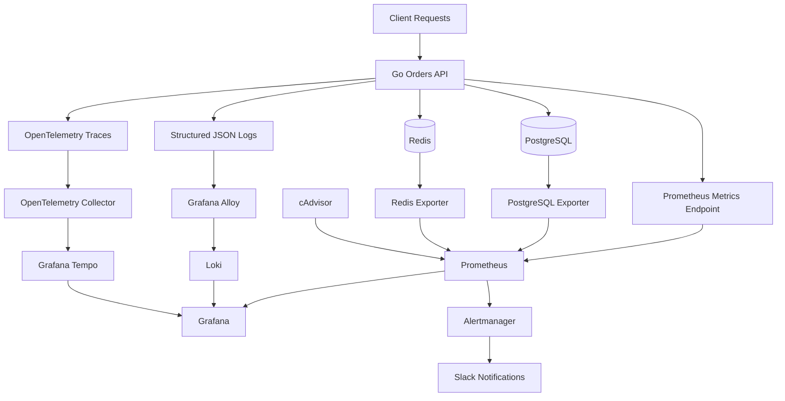

# Observability & Incident Monitoring 

A containerized observability platform for monitoring a Go API through metrics, structured logs, distributed tracing, dashboards, and alert notifications.

PulseOps demonstrates how application telemetry can be collected, correlated, visualized, and routed to an alerting destination using an open-source observability stack.

## Overview

Modern applications need more than application logs to diagnose failures. PulseOps brings together three core observability signals:

- **Metrics** — monitor request rates, HTTP errors, latency, cache operations, and infrastructure health.
- **Logs** — collect structured application logs and correlate log entries with distributed traces.
- **Traces** — follow requests across the API and its PostgreSQL and Redis dependencies.

Prometheus evaluates alerting rules, Alertmanager routes notifications to Slack, and Grafana provides a unified interface for exploring dashboards, logs, and traces.

## Architecture



### Telemetry flow

1. The Go API exposes application metrics through `/metrics`.
2. Prometheus scrapes application and infrastructure metrics and evaluates alert rules.
3. The API emits structured JSON logs containing trace correlation fields.
4. Grafana Alloy collects container logs and forwards them to Loki.
5. OpenTelemetry instrumentation exports traces through the OpenTelemetry Collector to Tempo.
6. Grafana connects to Prometheus, Loki, and Tempo for investigation and visualization.
7. Alertmanager routes Prometheus alerts to Slack.

## Technology Stack

| Component | Purpose |
|---|---|
| Go | Application API and instrumentation |
| PostgreSQL | Relational database |
| Redis | Cache |
| Docker Compose | Local multi-container orchestration |
| Prometheus | Metrics collection and alert evaluation |
| Grafana | Dashboards and telemetry exploration |
| OpenTelemetry Collector | Trace telemetry collection and export |
| Grafana Tempo | Distributed tracing backend |
| Grafana Loki | Log aggregation |
| Grafana Alloy | Container log collection and forwarding |
| Alertmanager | Alert grouping and notification routing |
| PostgreSQL Exporter | PostgreSQL metrics |
| Redis Exporter | Redis metrics |
| cAdvisor | Container resource metrics |
| Slack | Alert notification destination |

## Application Metrics

The API exposes Prometheus metrics, including:

- `orders_api_http_requests_total` — total HTTP requests, labeled by method, route, and status.
- `orders_api_http_request_duration_seconds` — HTTP request duration histogram, labeled by method and route.
- `orders_api_cache_operations_total` — cache operations, labeled by operation and outcome.

These metrics support request-rate analysis, latency percentiles, HTTP error monitoring, and cache behavior analysis.

Prometheus also scrapes the Prometheus server itself, PostgreSQL Exporter, Redis Exporter, and cAdvisor.

## Logging and Distributed Tracing

### Structured logs

Application logs use structured JSON and include trace correlation fields such as `trace_id` and `span_id`.

Grafana Alloy collects container logs and sends them to Loki. Grafana's Loki-to-Tempo correlation allows an investigator to move from a relevant log entry to its associated trace when the correlation data is available.

### Distributed traces

OpenTelemetry instrumentation captures API server spans and dependency spans for PostgreSQL and Redis.

Traces are exported through the OpenTelemetry Collector and stored in Tempo. This helps investigate request latency, dependency calls, and the sequence of operations within a request.

## Grafana Dashboard

The project includes a Go API observability dashboard with panels for:

- HTTP p95 request latency
- Request rate
- HTTP 5xx errors
- Cache hit ratio
- PostgreSQL health
- Redis health
- Container CPU and memory usage

The dashboard combines application-level signals with infrastructure health to support faster diagnosis.

## Alerting

Prometheus evaluates the rule defined in:

`observability/prometheus/rules/api-alerts.yml`

The configured alert is named `go-observability-alert`.

It fires when the ratio of HTTP 5xx responses to total API requests exceeds **5% over a five-minute rate window** and the condition remains true for **two minutes**.

The alert includes a warning severity and annotations describing the condition.

Alertmanager groups alerts by `alertname` and sends notifications to Slack. Resolved notifications are enabled.

### Alert delivery validation

A temporary test alert was used to verify the Prometheus → Alertmanager → Slack notification pipeline. The notification arrived in Slack.

The temporary rule was subsequently removed, and Prometheus was restored to load only the real API alert rule. The real rule was confirmed loaded with health `ok` and state `inactive`, which was expected when the threshold was not exceeded.

**Scope note:** the Slack delivery pipeline was tested successfully. A live HTTP 500 incident has not yet been demonstrated end to end through metrics, logs, traces, and recovery notifications.

## Prerequisites

Install the following before running the project:

- Docker Engine
- Docker Compose v2
- Git
- Access to a Slack incoming webhook if you want to enable Slack notifications

The Go application is built inside the Docker image, so a local Go installation is not required for the normal Compose workflow.

## Getting Started

### 1. Clone the repository

```bash
git clone <YOUR_REPOSITORY_URL>
cd observability-incident-lab
```

Replace `<YOUR_REPOSITORY_URL>` with your repository's Git URL.

### 2. Configure environment variables

Create a local `.env` file in the repository root. Never commit the real file.

At minimum, configure the PostgreSQL password and Slack webhook URL. The Compose configuration also supports these optional settings:

- `POSTGRES_USER` — defaults to `orders`
- `POSTGRES_DB` — defaults to `orders`
- `POSTGRES_PORT` — defaults to `5432`
- `REDIS_PORT` — defaults to `6379`
- `HTTP_PORT` — defaults to `8080`

Example `.env` structure:

```dotenv
POSTGRES_USER=orders
POSTGRES_PASSWORD=replace_with_a_local_password
POSTGRES_DB=orders

SLACK_WEBHOOK_URL=https://hooks.slack.com/services/REPLACE/ME
```

Replace all example values with your own values. Do not publish real passwords or webhook URLs.

### 3. Start the stack

```bash
docker compose up -d --build
```

Check container status:

```bash
docker compose ps
```

View service logs:

```bash
docker compose logs -f
```

### 4. Verify the API

Check API health:

```bash
curl -i http://localhost:8080/health
```

Expected response:

```json
{"status":"ok"}
```

Check application metrics:

```bash
curl -s http://localhost:8080/metrics
```

### 5. Open the observability interfaces

When running on your local machine, open:

| Service | URL |
|---|---|
| Grafana | http://localhost:3000 |
| Prometheus | http://localhost:9090 |
| Alertmanager | http://localhost:9093 |
| API health | http://localhost:8080/health |
| API metrics | http://localhost:8080/metrics |

If the stack runs on a remote server, use an appropriate secure access method rather than exposing observability interfaces publicly.

## Useful Commands

Check running containers:

```bash
docker compose ps
```

Follow API logs:

```bash
docker compose logs -f api
```

Follow Prometheus logs:

```bash
docker compose logs -f prometheus
```

Follow Alertmanager logs:

```bash
docker compose logs -f alertmanager
```

Validate the Prometheus configuration:

```bash
docker compose exec prometheus \
  promtool check config /etc/prometheus/prometheus.yml
```

Validate the API alert rules:

```bash
docker compose exec prometheus \
  promtool check rules /etc/prometheus/rules/api-alerts.yml
```

Stop the services without deleting persistent volumes:

```bash
docker compose down
```

Do not use `docker compose down -v` unless you intentionally want to delete the persistent data