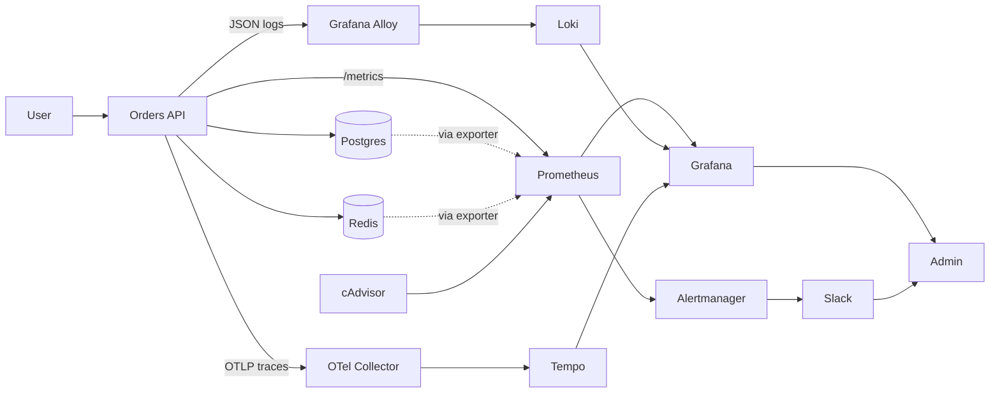

<div align="center">

# PulseOps

### Observability & Performance Engineering Lab

**Break it. Detect it. Diagnose it with metrics, logs, and traces. Fix it. Prove it.**

[](https://github.com/<you>/pulseops/actions)


[Demo video (90s)](LINK) · [Incident report](experiments/incident-001/REPORT.md) · [Architecture](docs/architecture.md) · [SLOs](docs/slo.md) · [Decisions](docs/decisions/)


</div>

---

## Table of contents

1. [Overview](#overview)
2. [Results at a glance](#results-at-a-glance)
3. [Quick start](#quick-start)
4. [Architecture](#architecture)
5. [The application](#the-application)
6. [Observability design](#observability-design)
7. [SLOs and alerting](#slos-and-alerting)
8. [Load testing](#load-testing)
9. [Incident 001](#incident-001)
10. [Configuration](#configuration)
11. [Make targets](#make-targets)
12. [Repository layout](#repository-layout)
13. [CI](#ci)
14. [Security and production hygiene](#security-and-production-hygiene)
15. [System requirements](#system-requirements)
16. [Troubleshooting](#troubleshooting)
17. [Known limitations](#known-limitations)
18. [Roadmap](#roadmap)
19. [What I learned](#what-i-learned)
20. [License](#license)

---

## Overview

Most observability demos show dashboards for a healthy service. PulseOps shows
the full reliability loop on a service that breaks:

| Step | What happens |
|---|---|
| **Detect** | A multi-window SLO burn-rate alert fires during a k6 load test |
| **Diagnose** | Metric spike → exemplar → trace → correlated logs → `EXPLAIN ANALYZE` |
| **Fix** | Resolve the root cause: `[e.g. add a missing index on orders.customer_id]` |
| **Verify** | Rerun the identical workload, compare results, confirm the alert resolves |

### What this project demonstrates

- Instrumenting a Go service with OpenTelemetry (traces) and Prometheus (metrics)
- Structured logging with trace correlation
- Designing SLIs, SLOs, and error budgets, and alerting on burn rate
- Repeatable load and stress testing with pass/fail thresholds
- Root-cause analysis across all three telemetry signals
- Writing a blameless postmortem backed by evidence

> **Scope:** this is a single-node local lab. It is built to be understood and
> reproduced, not to be a production benchmark.

---

## Results at a glance

Same k6 workload (`make load-stress`), before and after the fix for Incident 001.

| Metric | Before | After | Change |
|---|---|---|---|
| p50 latency | `[X] ms` | `[Y] ms` | `[−Z%]` |
| p95 latency | `[X] ms` | `[Y] ms` | `[−Z%]` |
| p99 latency | `[X] ms` | `[Y] ms` | `[−Z%]` |
| Error rate | `[X]%` | `[Y]%` | `[...]` |
| Throughput | `[X] req/s` | `[Y] req/s` | `[+Z%]` |
| Peak API CPU | `[X]%` | `[Y]%` | `[...]` |
| Cache hit ratio | `[X]%` | `[Y]%` | `[...]` |
| Alert state | `FastBurn firing` | `resolved in [N] min` | |

**Test conditions:** `[CPU model, cores, RAM, OS, Docker version]` · commit `[sha]` ·
each run repeated 3 times, median reported · raw data in
[`experiments/incident-001/results/`](experiments/incident-001/results/).

---

## Quick start

### Prerequisites

| Tool | Version |
|---|---|
| Docker | 24+ |
| Docker Compose | v2 |
| make | any |
| k6 | 0.50+ |
| Git | any |

### Run it

```bash
git clone https://github.com/<you>/pulseops && cd pulseops
cp .env.example .env        # review values, set a Grafana password
make up                     # start the full stack
make seed                   # load sample customers and orders
make load-baseline          # send healthy traffic
```

Open Grafana and go to **Dashboards → PulseOps: Service Health**.

| Service | URL | Notes |
|---|---|---|
| Grafana | http://localhost:3000 | credentials from `.env` |
| Orders API | http://localhost:8080 | |
| Prometheus | http://localhost:9090 | |
| Alertmanager | http://localhost:9093 | |

Stop everything with `make down`, or wipe all data with `make clean`.

### Reproduce the incident

```bash
make up && make seed
make load-baseline          # 1. observe the healthy state first
make incident-1             # 2. enable the fault
make load-stress            # 3. apply load, then investigate in Grafana
make fix-1                  # 4. apply the fix
make load-stress            # 5. rerun the identical workload
make report                 # 6. print a before/after summary
```

For the best experience, do step 3 **without reading the incident report first**,
and find the root cause from the telemetry alone.

---

## Architecture




### Components

| Component | Role | Why this one |
|---|---|---|
| **Orders API (Go)** | Application under test | Small, fast, and exposes useful runtime metrics |
| **Postgres** | Primary data store | Supports `EXPLAIN ANALYZE` for root-cause proof |
| **Redis** | Cache | Makes cache hit ratio part of the incident story |
| **OpenTelemetry Collector** | Receives and exports traces | Vendor-neutral pipeline |
| **Grafana Alloy** | Collects container logs | Promtail is end-of-life |
| **Prometheus** | Metrics storage, rules, exemplars | Standard for metrics and SLO math |
| **Loki** | Log storage | Label-based, works well with Grafana |
| **Tempo** | Trace storage | Native exemplar and trace-to-log links in Grafana |
| **Grafana** | Dashboards and investigation | One place to move across all three signals |
| **Alertmanager** | Group, route, silence alerts | Separates alert logic from delivery |
| **cAdvisor** | Container CPU and memory | Shows saturation during load |
| **Postgres / Redis exporters** | Dependency metrics | Pool, cache, and DB health |
| **k6** | Load generation | Scriptable, with built-in thresholds |

### Signal flow

| Signal | Path |
|---|---|
| Metrics | API `/metrics` → Prometheus → Grafana |
| Traces | API → OTLP → OTel Collector → Tempo → Grafana |
| Logs | API stdout → Alloy → Loki → Grafana |
| Exemplars | Histogram bucket in Prometheus → `trace_id` → Tempo |
| Alerts | Prometheus rules → Alertmanager → Slack |

Design rationale and rejected alternatives are in [`docs/decisions/`](docs/decisions/).

---

## The application

The Orders API is intentionally small, with realistic dependencies so that
traces contain meaningful spans.

| Endpoint | Behavior |
|---|---|
| `POST /orders` | Insert into Postgres, invalidate the Redis cache entry |
| `GET /orders/{id}` | Cache-aside: Redis first, Postgres on miss, then cache fill |
| `GET /customers/{id}/orders` | Order history for a customer (the incident endpoint) |
| `GET /health` | Liveness, always cheap |
| `GET /ready` | Readiness, checks Postgres and Redis |
| `GET /metrics` | Prometheus scrape endpoint |
| `POST /admin/faults` | Toggle fault injection (requires `FAULTS_ENABLED=true`) |

### Fault injection

Faults are **deterministic and configurable**, so an incident can be reproduced
on demand rather than depending on random failures.

| Fault | Effect | Parameter |
|---|---|---|
| `slow_query` | Removes the index so the query does a sequential scan | none |
| `latency` | Adds fixed delay to a route | `route`, `delay_ms` |
| `errors` | Returns 5xx for a fraction of requests | `route`, `rate` |
| `pool_limit` | Shrinks the DB connection pool | `max_conns` |
| `cache_flush` | Clears Redis to simulate a cold cache | none |

```bash
curl -X POST localhost:8080/admin/faults \
  -H "Content-Type: application/json" \
  -d '{"fault":"latency","route":"/orders/{id}","delay_ms":400}'
```

The endpoint returns `404` unless `FAULTS_ENABLED=true`. It is off by default.

---

## Observability design

### Metrics

| Metric | Type | Labels |
|---|---|---|
| `http_requests_total` | counter | `service`, `env`, `method`, `route`, `status_class` |
| `http_request_duration_seconds` | histogram (with exemplars) | `service`, `env`, `method`, `route` |
| `http_requests_in_flight` | gauge | `service`, `env` |
| `db_pool_connections{state}` | gauge | `service`, `env`, `state` |
| `db_pool_wait_seconds` | histogram | `service`, `env` |
| `cache_requests_total{result}` | counter | `service`, `env`, `result` (`hit`/`miss`) |
| Go runtime (`go_*`) | various | goroutines, GC, heap |
| Container (`container_*`) | various | via cAdvisor |

**Rules:** route labels use templates (`/orders/{id}`), never raw paths. User
IDs, order IDs, and trace IDs are never metric labels.

### Logs

Structured JSON, one object per line:

```json
{
  "ts": "[timestamp]",
  "level": "error",
  "service": "orders-api",
  "env": "local",
  "route": "/customers/{id}/orders",
  "trace_id": "[32-hex]",
  "span_id": "[16-hex]",
  "msg": "query exceeded threshold",
  "duration_ms": 1840
}
```

### Traces

Each request produces a trace with spans for:

- the HTTP handler
- each Postgres query (with sanitized statement)
- each Redis call

### Cross-signal navigation

```
Latency panel (metric)
   └─ click exemplar ──▶ Trace in Tempo
                            └─ "Logs for this span" ──▶ Loki (filtered by trace_id)
Log line in Loki
   └─ click trace_id ──▶ Trace in Tempo
```

This works because:
1. Histograms record exemplars containing the `trace_id`.
2. Logs contain the same `trace_id`.
3. Grafana datasources are provisioned with the linking rules
   (see [`observability/grafana/provisioning/datasources/`](observability/grafana/provisioning/datasources/)).

### Dashboard: PulseOps, Service Health

| Row | Panels |
|---|---|
| **Overview** | Request rate · error rate · p50/p95/p99 · active alerts |
| **Traffic** | Status codes by route · in-flight requests · current load-test phase |
| **Dependencies** | DB pool usage and wait time · cache hit ratio · Postgres and Redis health |
| **Resources** | API CPU and memory · GC pause · goroutines |
| **SLO** | Availability SLI · latency SLI · remaining error budget · burn rate |

---

## SLOs and alerting

### Service level objectives

| SLI | Definition | Objective | Window |
|---|---|---|---|
| Availability | non-5xx requests ÷ total requests, excluding `/health` and `/ready` | 99.5% | 28 days |
| Latency | requests faster than `[300 ms]` ÷ total requests | 95% | 28 days |

**Error budget (availability):** 0.5% of requests. At `[N]` requests per day,
that is about `[M]` failed requests per 28 days. Full math in
[`docs/slo.md`](docs/slo.md).

### Alerts

Alerts use multi-window, multi-burn-rate rules (from the Google SRE Workbook)
so brief spikes don't page anyone but sustained burns do.

| Alert | Condition | Severity | Action |
|---|---|---|---|
| `ErrorBudgetFastBurn` | 14.4× burn over 1h **and** 5m | page | [runbook](runbooks/fast-burn.md) |
| `ErrorBudgetSlowBurn` | 6× burn over 6h **and** 30m | ticket | [runbook](runbooks/slow-burn.md) |
| `HighP95Latency` | p95 > `[300 ms]` for 10m | warning | [runbook](runbooks/latency.md) |
| `DBPoolSaturated` | pool wait > `[x]` for 5m | warning | [runbook](runbooks/db-pool.md) |
| `CacheHitRatioLow` | hit ratio < `[x]%` for 10m | warning | [runbook](runbooks/cache.md) |

Every alert has a severity, a description, and a runbook link. Rules are
unit-tested:

```bash
make test-rules    # promtool check rules && promtool test rules
```

Alerts are routed by Alertmanager to Slack (`[channel]`). Health endpoints are
excluded from alert math to avoid misleading signals.

---

## Load testing

All scenarios live in [`load-tests/`](load-tests/) and use fixed parameters so
results are comparable.

| Scenario | Command | Profile | Purpose |
|---|---|---|---|
| Baseline | `make load-baseline` | `[N]` VUs for `[T]` min | Healthy reference |
| Ramp-up | `make load-ramp` | `[0 → N]` VUs over `[T]` min | Find where latency starts to bend |
| Spike | `make load-spike` | sudden `[5×]` jump for `[T]` s | Test sudden-traffic behavior |
| Soak | `make load-soak` | `[N]` VUs for `[T]` min | Detect leaks and slow degradation |
| Recovery | `make load-recovery` | return to baseline | Confirm alerts clear |
| Stress | `make load-stress` | ramp + spike combined | Used for the incident |

Each script defines **thresholds** that fail the run if SLIs are breached:

```javascript
export const options = {
  thresholds: {
    http_req_failed:   ['rate<0.005'],   // matches the availability SLO
    http_req_duration: ['p(95)<300'],    // matches the latency SLO
  },
};
```

> Load is generated on the same machine as the stack, so results are relative,
> not absolute. Always compare runs on the same hardware.

---

## Incident 001

**Title:** `[e.g. p95 latency spike on customer order history]`
**Full postmortem:** [`experiments/incident-001/REPORT.md`](experiments/incident-001/REPORT.md)

| | |
|---|---|
| **Detected** | `ErrorBudgetFastBurn` fired at `[time]`, `[N]` min after load began |
| **Impact** | `[X%]` of requests exceeded `[Y ms]` for `[Z]` min |
| **Root cause** | `[e.g. sequential scan on orders; no index on customer_id]` |
| **Evidence** | Latency panel → exemplar → trace (DB span `[N] ms`) → logs → `EXPLAIN ANALYZE` |
| **Fix** | `[CREATE INDEX CONCURRENTLY ...]` |
| **Verification** | Same k6 workload, results in the table above, alert resolved in `[N]` min |
| **Follow-ups** | `[slow-query alert, index review in PR checklist, query timeout]` |


### Investigation path

1. **Alert:** `ErrorBudgetFastBurn` fires in Slack
2. **Dashboard:** p95 jumps on `/customers/{id}/orders` only; other routes are healthy
3. **Exemplar:** click the spike to open a slow trace
4. **Trace:** the Postgres span accounts for `[X]%` of request time
5. **Logs:** correlated log lines show `[query details]`
6. **Proof:** `EXPLAIN ANALYZE` shows `Seq Scan on orders`
7. **Fix and verify:** add the index, rerun the workload, confirm recovery

---

## Configuration

Copy `.env.example` to `.env`. Never commit `.env`.

| Variable | Default | Description |
|---|---|---|
| `ENV` | `local` | Environment label on all telemetry |
| `FAULTS_ENABLED` | `false` | Enables `/admin/faults` |
| `DB_MAX_CONNS` | `[20]` | Postgres pool size |
| `GRAFANA_ADMIN_USER` | `admin` | Grafana login |
| `GRAFANA_ADMIN_PASSWORD` | *(set this)* | Grafana password |
| `SLACK_WEBHOOK_URL` | *(empty)* | Alert delivery; leave empty to disable |
| `PROM_RETENTION` | `[7d]` | Prometheus retention |
| `LOKI_RETENTION` | `[72h]` | Loki retention |
| `TEMPO_RETENTION` | `[72h]` | Tempo retention |

---

## Make targets

| Target | Description |
|---|---|
| `make up` | Start the full stack |
| `make down` | Stop the stack, keep data |
| `make clean` | Stop and delete all volumes |
| `make seed` | Load sample data |
| `make logs` | Tail all service logs |
| `make load-baseline` / `load-ramp` / `load-spike` / `load-soak` / `load-recovery` / `load-stress` | Run k6 scenarios |
| `make incident-1` | Enable the Incident 001 fault |
| `make fix-1` | Apply the fix |
| `make test` | App unit tests |
| `make test-rules` | Validate and unit-test Prometheus rules |
| `make lint` | Lint code and configs |
| `make report` | Summarize before/after results |

---

## Repository layout

```
pulseops/
├── app/                    # Orders API and OpenTelemetry instrumentation
├── load-tests/             # k6 scenarios and thresholds
├── observability/
│   ├── prometheus/         # scrape config, recording and alert rules, rule tests
│   ├── grafana/            # provisioned datasources and dashboards
│   ├── loki/
│   ├── alloy/
│   ├── tempo/
│   ├── otel-collector/
│   └── alertmanager/
├── runbooks/               # one per alert
├── experiments/
│   └── incident-001/       # REPORT.md, raw results, screenshots
├── docs/
│   ├── img/
│   ├── decisions/          # ADRs
│   ├── architecture.md
│   └── slo.md
├── .github/workflows/      # CI
├── docker-compose.yml
├── Makefile
├── .env.example
└── README.md
```

---

## CI

GitHub Actions runs on every pull request:

| Step | Purpose |
|---|---|
| Unit tests and lint | App correctness and style |
| `promtool check rules` | Rule syntax |
| `promtool test rules` | Alert logic against synthetic series |
| Dashboard JSON validation | Catch broken dashboards |
| `docker compose config` | Validate the compose file |
| k6 smoke test | Stack boots and serves traffic |

---

## Security and production hygiene

- Fault injection endpoint is disabled by default
- Grafana requires authentication; anonymous access is off
- No secrets in the repository; `.env.example` contains placeholders only
- Container images are pinned to specific versions
- Retention limits set on Prometheus, Loki, and Tempo
- Metric labels are low-cardinality
- Health and readiness checks are excluded from SLO math
- Consistent `service` and `env` labels across metrics, logs, and traces

---

## System requirements

| Resource | Minimum | Comfortable |
|---|---|---|
| RAM | `[measured]` GB | 16 GB |
| CPU | 4 cores | 8 cores |
| Disk | 10 GB free | 20 GB |

The full stack runs about 13 containers. Running k6 on the same machine competes
for resources, so record your hardware with every result.

---

## Troubleshooting

| Problem | Likely cause | Fix |
|---|---|---|
| Grafana shows no data | Datasource not provisioned or Prometheus not scraping | Check Prometheus → Status → Targets |
| No exemplars on latency panel | Exemplar storage disabled | Start Prometheus with `--enable-feature=exemplar-storage` and enable exemplars on the panel |
| Trace has no "Logs" link | Loki datasource missing derived field or `trace_id` mismatch | Check the Tempo datasource trace-to-logs config |
| Logs missing in Loki | Alloy cannot read the Docker socket | Check Alloy mounts and logs |
| Alerts never fire | Load too small, or windows not yet filled | Run the stress test for the full window |
| Containers restart under load | Not enough RAM | Reduce retention, lower VUs, close other apps |
| `make up` fails on port in use | Another service on 3000/8080/9090 | Change ports in `.env` |

---

## Known limitations

- Single-node local lab; numbers depend on your hardware
- k6 shares the machine with the system under test
- No high availability for the observability stack
- Synthetic traffic only
- Alert delivery tested with Slack only
- No Kubernetes deployment yet

## Roadmap

- [ ] Helm chart and Kubernetes variant
- [ ] Second incident: `[memory leak / cache stampede / connection pool exhaustion]`
- [ ] Continuous profiling with Pyroscope
- [ ] Terraform deployment to a cloud VM
- [ ] SLO dashboard generated from SLO definitions (Sloth or Pyrra)

---

## What I learned

`[Write 4 to 6 honest bullets. For example:]`
- `[What surprised you about the telemetry]`
- `[What you got wrong first, and how you found out]`
- `[What was hardest to get working, such as exemplars or trace-to-log links]`
- `[What you would change if you rebuilt it]`

---

## License

MIT. See [LICENSE](LICENSE).

## Acknowledgements

- Google SRE Workbook: multi-window, multi-burn-rate alerting
- Grafana Labs, Prometheus, and OpenTelemetry documentation
